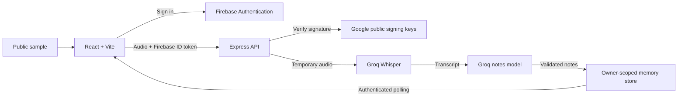

# Smart Meetings Notes Generator

Turn a short meeting recording into a transcript, summary and follow-up list. This final-year portfolio project combines a React interface with an authenticated Node.js API. The public example uses fictional meeting content and works independently of the live processing service.

## Try it

[Open the public sample meeting](https://moeezsajjad.github.io/Smart-Meetings-Notes-Generator/#/sample). Read the discussion, review the decisions and action items, and download the notes. Live uploads are a separate, restricted feature. Use a short synthetic recording for demonstrations.

## How it works



## Run on Windows

Install Node.js 22 LTS and npm. In a terminal at the repository root:

```powershell
cd frontend
npm ci
npm run dev
```

Open the URL printed by Vite. The sample needs no account or API keys. For live uploads also follow the [API setup](backend/README.md), then configure the browser using the [frontend guide](frontend/README.md). Restart Vite when changing environment variables.

## Documentation

- [Frontend and recruiter walkthrough](frontend/README.md)
- [Backend setup, environment and endpoint reference](backend/README.md)
- [Security audit, test evidence and limitations](AUDIT.md)
- [Free deployment and troubleshooting](DEPLOYMENT.md)

The API is a single-instance demo. It keeps meeting results in memory for approximately one hour and loses them on restart. Download the notes before they expire. A pending upload can be interrupted by a host restart or quota limit. Accuracy depends on the audio and model. Review generated text before using it.
